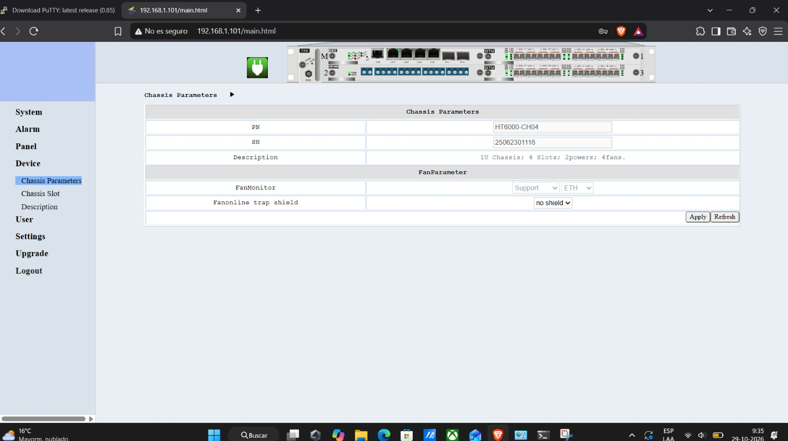
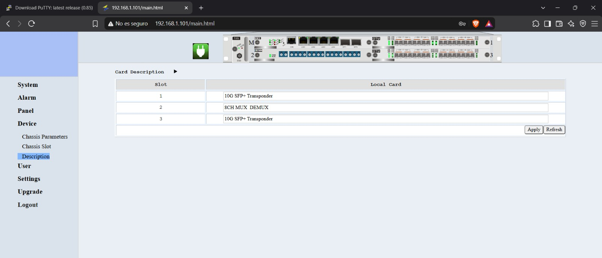

# 2. Inventario de Equipos y Componentes

A continuación, se detalla la función, tipo de interfaz y rol técnico de cada componente de la maqueta de laboratorio DWDM.

## 1. Analizador Ethernet (VeEX MTX150x)
**Función:** Equipo de medición de tráfico de red y pruebas de estrés. Genera tráfico Ethernet en capas L2/L3.
**Rol Técnico:** Simular tráfico de cliente en la red y ejecutar pruebas estandarizadas como RFC 2544 e ITU-T Y.1564 para validar el rendimiento (Throughput, Latencia, Jitter, Pérdida de tramas).

## 2. Analizador de Espectro Óptico - OSA (VeEX RXT-4510)
**Función:** Instrumento de medición óptica avanzada.
**Rol Técnico:** Analizar el espectro óptico de la señal DWDM transmitida, permitiendo visualizar la potencia por canal (dBm), la longitud de onda central y medir la Relación Señal a Ruido Óptica (OSNR), parámetro crítico para garantizar la calidad del enlace.

## 3. Switch Ethernet (MikroTik CSS610)
**Función:** Dispositivo de conmutación de capa de enlace de datos.
**Rol Técnico:** Actúa como equipo de agregación en el lado del cliente (CPE). Recibe el tráfico Ethernet convencional y lo envía hacia el chasis DWDM para su multiplexación. Cuenta con interfaces RJ45 y SFP+.

## 4. ODF (Optical Distribution Frame)
**Función:** Panel de parcheo óptico pasivo.
**Rol Técnico:** Centralizar y organizar las conexiones físicas de fibra óptica. Facilita la interconexión segura entre los puertos de línea del chasis HT6000, los carretes de fibra y la instrumentación, protegiendo los delicados hilos de fibra.

## 5. Chasis DWDM 1 y DWDM 2 (HT6000)
**Función:** Plataforma de transporte óptico. Es el corazón del sistema DWDM.
**Rol Técnico:** Aloja las tarjetas transpondedoras (conversión de señal cliente a longitud de onda DWDM) y los módulos Mux/Demux.

### Especificaciones y Tarjetas de Línea
Según la interfaz de gestión NMS del equipo, el chasis es de 1U y cuenta con 4 slots, 2 fuentes de alimentación (PSU) y 4 ventiladores:

Las tarjetas instaladas en los slots son las siguientes:
* **Slot 1:** Tarjeta Transponder 10G SFP+ (HT6000-OTUQS2S). Convierte señales de cliente a longitudes de onda DWDM.
* **Slot 2:** Módulo 8CH MUX DEMUX (HT6000-ODM08-MON). Multiplexa y demultiplexa hasta 8 canales ópticos.
* **Slot 3:** Tarjeta Transponder 10G SFP+ (HT6000-OTUQS2S).

## 6. Carretes de Fibra Óptica (AB - 25 KM y BA - 25 KM)
**Función:** Medio de transmisión físico simulado.
**Rol Técnico:** Bobinas de fibra óptica monomodo (G.652) que emulan un enlace real de larga distancia (25 kilómetros de ida y 25 km de retorno). Introducen atenuación natural y dispersión en la señal, permitiendo probar los equipos bajo condiciones reales de red.

## 7. Atenuador Óptico Variable - OVA (JW3303)
**Función:** Control de pérdida óptica.
**Rol Técnico:** Se inserta en el enlace para inducir de forma manual y controlada niveles de atenuación adicionales (dB). Es fundamental para simular degradaciones del enlace o pérdidas por empalmes y verificar el umbral de sensibilidad de los receptores.