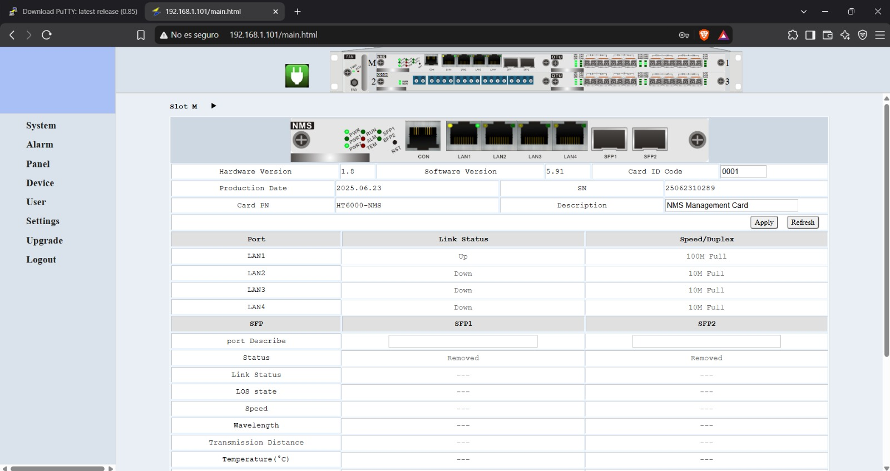
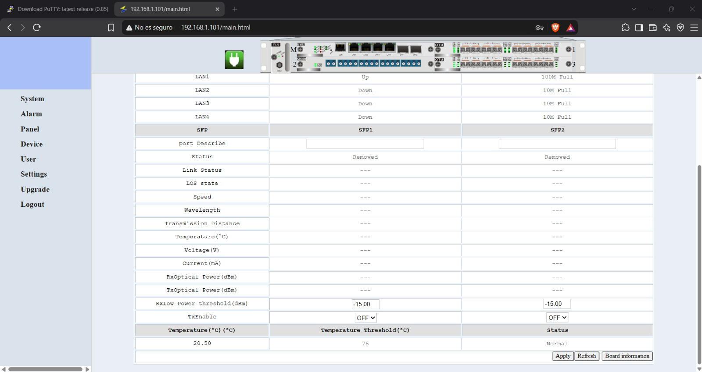
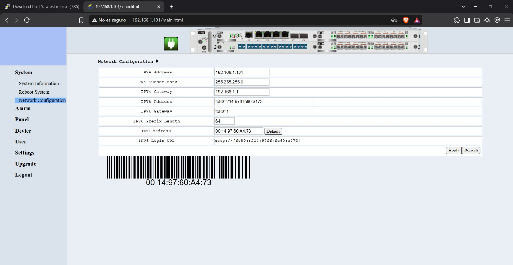

# 3. Manual de Configuración y Seguridad

## Medidas de Seguridad Óptica
El trabajo con equipos DWDM implica la manipulación y exposición a radiación láser no visible (Clase 1M / 3R), la cual puede causar daños severos e irreversibles en la retina.
* **Protección Ocular:** Jamás se debe mirar directamente al extremo de una fibra óptica activa, puerto de equipo o conector del transceptor.
* **Manejo de Conectores (APC/UPC):** Es vital identificar el pulido de los conectores. Los conectores APC no deben conectarse directamente con conectores UPC sin adaptador.
* **Limpieza Obligatoria:** Antes de realizar cualquier conexión en el ODF o los equipos, se deben limpiar los conectores con lápices limpiadores o casetes ópticos.

## Configuración del Chasis HT6000
El aprovisionamiento de servicios se realiza accediendo al sistema de gestión de red (NMS) del chasis mediante su interfaz web IP.

1. **Autenticación:** Ingreso con perfil de administrador al portal del HT6000.
2. **Revisión de Alarmas:** Verificar en el log de sistema que las tarjetas y fuentes operen sin errores críticos.
3. **Mapeo de Puertos:** Configurar las tarjetas Transponder para asociar el tráfico de cliente con las longitudes de onda de la banda C.

## Procedimiento de Prueba y Medición
Para validar la operatividad del enlace, se ejecutan las siguientes secuencias de control y monitoreo en los paneles de administración:

