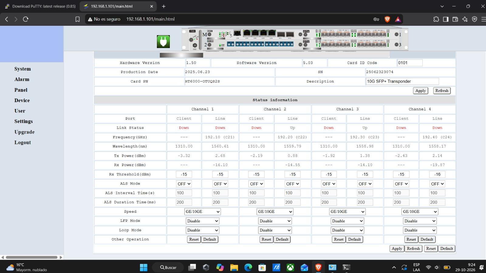
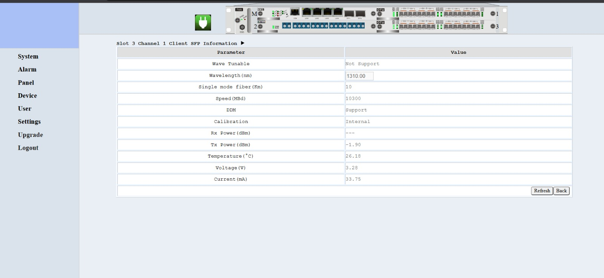
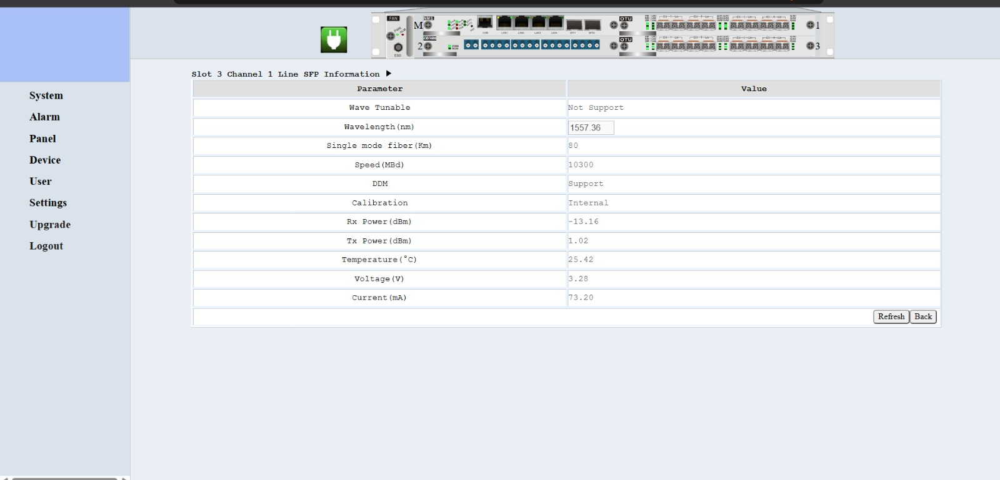
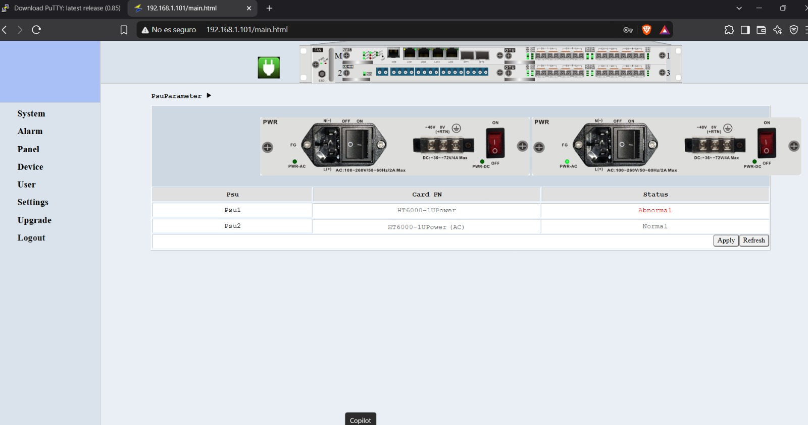

# 4. Esquemas de Red y Flujo de Señal

## Diagrama de Conexiones Físicas
El siguiente conjunto de esquemas ilustra las mediciones, el espectro óptico y el flujo de la señal a través de la infraestructura de transporte DWDM del laboratorio.

## Mapeo de Puertos y Flujo de Señal
* **Analizador MTX150x** <--> **Switch CSS610**: Inyección de tráfico Ethernet inicial.
* **Switch CSS610** <--> **Chasis HT6000**: Agregación de servicios hacia el transpondedor.
* **Chasis HT6000** <--> **Módulo MUX / ODF**: Multiplexación y salida hacia el medio de transmisión de fibra óptica.