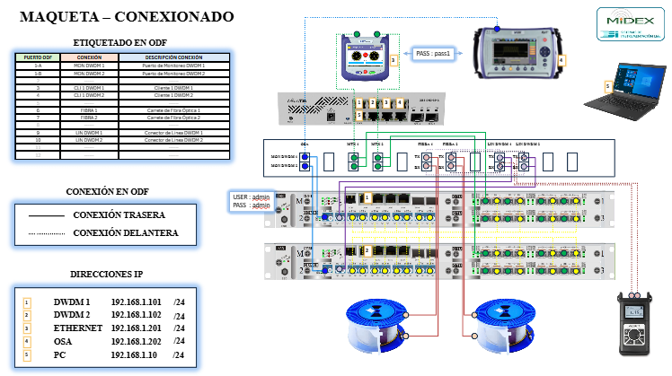

# 4. Esquemas de Red y Flujo de Señal

## Diagrama de Conexiones Físicas y Topología
El siguiente diagrama ilustra la topología física completa de la maqueta de laboratorio, detallando el cableado entre la instrumentación, los equipos de agregación, la red de transporte DWDM y el etiquetado del ODF:

## Matriz de Direccionamiento IP
* **DWDM 1:** `192.168.1.101 /24`
* **DWDM 2:** `192.168.1.102 /24`
* **ETHERNET:** `192.168.1.201 /24`
* **OSA:** `192.168.1.202 /24`
* **PC:** `192.168.1.10 /24`

## Mapeo de Puertos en ODF
* **Puerto 1-A / 1-B:** Monitoreo DWDM 1 y 2.
* **Puerto 3 / 4:** Conexión de Cliente 1 (Cliente 1 DWDM 1 / 2).
* **Puerto 6 / 7:** Enlaces hacia los Carretes de Fibra Óptica 1 y 2.
* **Puerto 9 / 10:** Conectores de Línea DWDM 1 y 2.

## Flujo de la Señal y Validación de Topología
Las siguientes capturas muestran el estado global de la red y las validaciones de conectividad ejecutadas en la topología:

